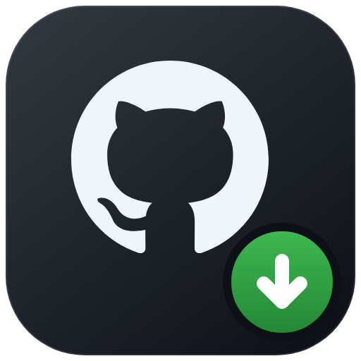
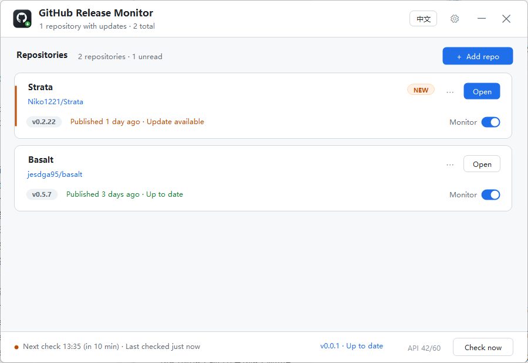
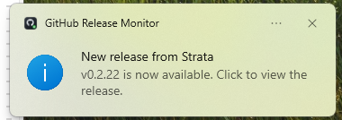
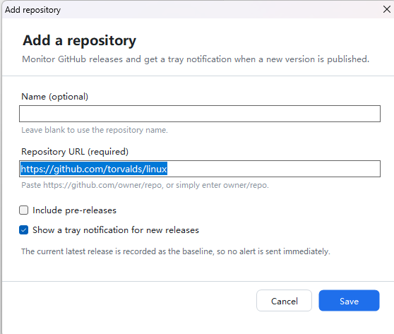
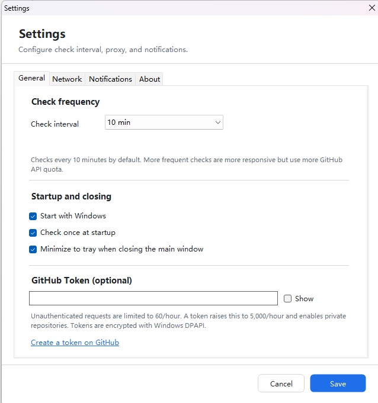
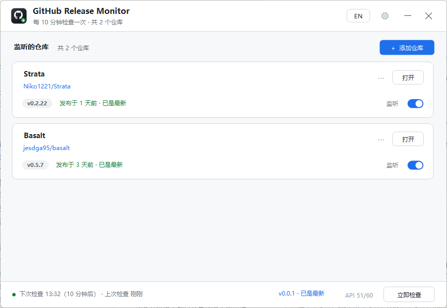
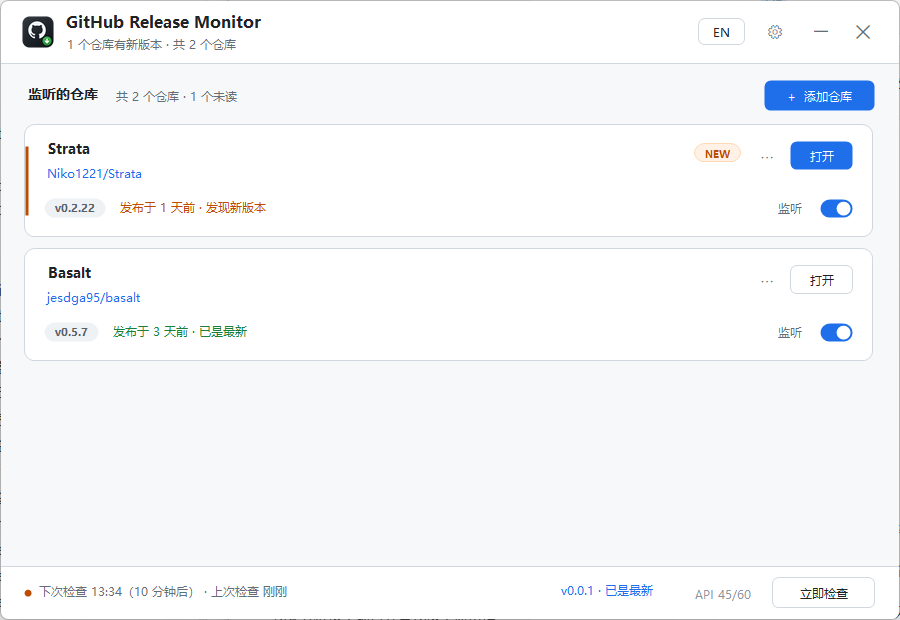
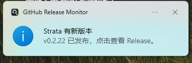
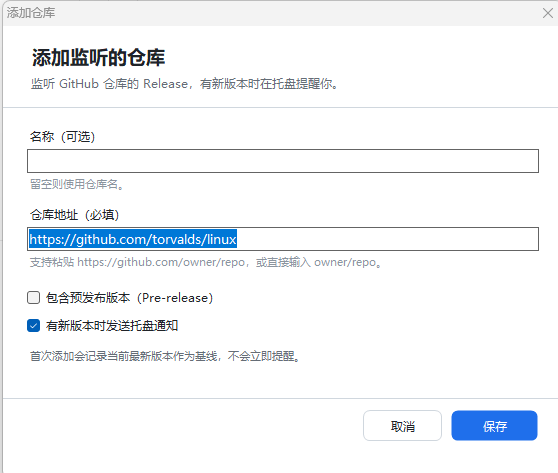
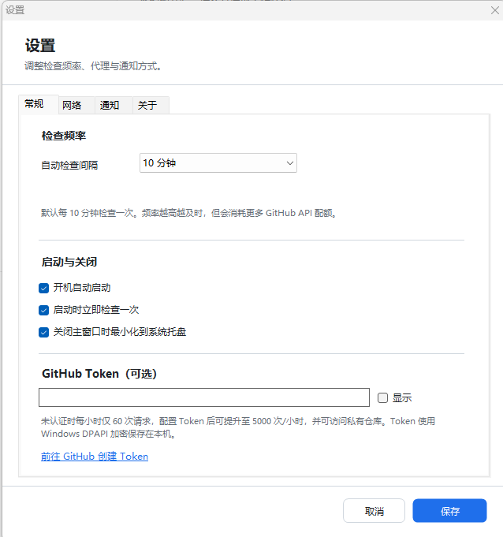

# GitHub Release Monitor

[English](#en) &nbsp;|&nbsp; [简体中文](#zh)

Completely free and open source · [github.com/yutils/GitHubReleaseMonitor](https://github.com/yutils/GitHubReleaseMonitor)

<a id="en"></a>
## English

A Windows tray utility that watches GitHub releases and notifies you in the bottom-right corner. Single-file exe with no third-party DLLs.

**Current version: v0.0.1** · **Free:** this software is completely free · **Source:** [yutils/GitHubReleaseMonitor](https://github.com/yutils/GitHubReleaseMonitor)

**Language**: click `EN` / `中文` in the top-right corner to switch instantly. Your choice is saved automatically.

### Features

- **Release monitoring**: checks GitHub Releases on a schedule and shows a Windows notification; click it to open the release page.
- **Multiple repositories**: custom names, edit, delete, pause, pre-releases, and per-repository notifications.
- **Read state**: each version is announced once; new versions show `NEW` and a tray icon dot, and can be marked as read.
- **Check interval**: 5/10/15/30 minutes, 1/2/6/12/24 hours, or a custom 1–1440 minutes. Default is 10 minutes.
- **Proxy**: system proxy (default), direct connection, or an HTTP/HTTPS proxy with optional credentials. Includes a connection test.
- **GitHub Token**: optional; raises the API limit from 60 to 5,000 requests/hour and enables private repositories.
- **Tray and startup**: close `×` to the tray; start with Windows and start minimized by default; a second launch restores the existing window.
- **Status feedback**: next-check countdown, last check, remaining API quota, errors, and optional failure notifications.
- **Self-update check**: checks the project's own GitHub release on startup. A red dot appears next to the version when a newer version exists; network failures are silent. Check manually from the version link or the tray menu.
- **Bilingual UI**: switch between Chinese and English from the top-right corner; all windows, tray menus, and notifications update immediately.

### Screenshots



<p></p>

<p>
  
  
</p>

### Usage

1. Download `GitHubReleaseMonitor-v0.0.1.exe` from the project's Releases page and run it (Windows 10/11 includes .NET Framework 4.8).
2. Click **Add repo** and paste `https://github.com/owner/repo`, or enter `owner/repo`.
3. The latest release is recorded as the baseline on first add, so no immediate alert is sent.
4. Click `×` to hide to the tray. Double-click the tray icon to reopen; right-click for **Check now**, **Check for updates**, or **Exit**.
5. Click the version link at the bottom of the window to check for software updates. When an update exists, click the version or tray menu item to open the release page.
6. Drag the title bar or any blank area to move the window. The repository list scrolls vertically when needed.

### Shortcuts

| Shortcut | Action |
| --- | --- |
| `Ctrl+N` | Add repository |
| `Ctrl+R` / `F5` | Check now |
| `Ctrl+,` | Open settings |

### Self-update & releases

- On launch, the app checks `https://github.com/yutils/GitHubReleaseMonitor/releases/latest`. Connection/API failures are ignored silently.
- Click the version at the bottom (`v0.0.1 · Check for updates`) or use the tray menu to check manually.
- When a newer release is available, a red dot appears beside the version and on the tray icon; click the version to open the release.
- Release convention: tag `0.0.1`, release title `v0.0.1`, asset `GitHubReleaseMonitor-v0.0.1.exe`. The app reads the release tag (falling back to the release title) and compares the numeric version.

### Data & security

- Config and logs: `%APPDATA%\GitHubReleaseMonitor\`.
- GitHub tokens and proxy passwords are encrypted with Windows DPAPI; only the current Windows user can decrypt them.
- Without a token, GitHub API access is limited to 60 requests/hour. Private repositories require a token with `repo` scope.
- Only HTTP/HTTPS proxies are supported. The system proxy follows Windows network settings.
- Notifications depend on Windows notification permissions. On first run, choose **More info → Run anyway** if SmartScreen appears.

### Build

Requires Windows 10/11 and the built-in .NET Framework 4.x compiler; Visual Studio is not required.

```bat
build.bat
```

Or:

```powershell
powershell -NoProfile -ExecutionPolicy Bypass -File .\build.ps1
```

The version is read from `src/AssemblyInfo.cs`. Output: `dist\GitHubReleaseMonitor-v0.0.1.exe` (single file, no extra DLLs).

<a id="zh"></a>
## 简体中文

Windows 托盘工具，监听 GitHub 仓库的 Release，有新版本时在屏幕右下角提醒。单文件 exe，无第三方 DLL。

**当前版本：v0.0.1** · **完全免费** · **开源地址：**[yutils/GitHubReleaseMonitor](https://github.com/yutils/GitHubReleaseMonitor)

**切换语言**：点击主界面右上角的 `EN` / `中文` 按钮即可即时切换，设置会自动保存。

### 功能

- **Release 监听**：定时检查 GitHub Releases，新版本弹出右下角通知，点击直达发布页。
- **多仓库管理**：自定义名称、编辑、删除、暂停监听；支持 Pre-release 和单仓库通知开关。
- **已读状态**：同一版本只提醒一次；新版本显示 `NEW` 和托盘红点，可手动标记已读。
- **检查频率**：5/10/15/30 分钟、1/2/6/12/24 小时或 1–1440 分钟自定义；默认 10 分钟。
- **代理**：系统代理（默认）、直连或 HTTP/HTTPS 代理（支持账号密码），内置连接测试。
- **GitHub Token**：可选，用于提升 API 限额（60 → 5000 次/小时）并访问私有仓库。
- **托盘与自启**：`×` 最小化到托盘；默认开机自启、静默启动；重复启动唤醒已有窗口。
- **状态反馈**：检查倒计时、上次检查、API 剩余额度、失败原因；可开启失败通知。
- **软件自更新检查**：启动时检查本项目 GitHub Release；有新版时版本号旁显示小红点，网络失败静默不提示。可点击版本号或托盘菜单手动检查。
- **中英文界面**：主界面右上角即时切换，所有窗口、托盘菜单和通知同步切换。

### 截图

<p>
  
  
</p>

<p></p>

<p>
  
  
</p>

### 使用

1. 从项目的 Releases 页面下载 `GitHubReleaseMonitor-v0.0.1.exe` 并运行（Windows 10/11 自带 .NET Framework 4.8）。
2. 点击「添加仓库」，粘贴 `https://github.com/owner/repo` 或直接输入 `owner/repo`。
3. 首次添加以当前最新 Release 为基线，不会立即提醒；之后的版本变化会通知。
4. 点击 `×` 隐藏到托盘继续检查。双击托盘图标打开主界面，右键可立即检查、检查更新或退出。
5. 点击窗口底部版本号检查软件更新；发现新版本后，点击版本号或托盘菜单打开 Release 页面。
6. 窗口可拖动标题栏或界面空白处移动；仓库较多时列表自动纵向滚动。

### 快捷键

| 快捷键 | 功能 |
| --- | --- |
| `Ctrl+N` | 添加仓库 |
| `Ctrl+R` / `F5` | 立即检查更新 |
| `Ctrl+,` | 打开设置 |

### 软件更新与发布

- 启动时检查 `https://github.com/yutils/GitHubReleaseMonitor/releases/latest`；连接或 API 失败时静默忽略。
- 点击底部版本号（`v0.0.1 · 检查更新`）或托盘菜单「检查更新」可手动检查。
- 发现更高版本时，版本号旁和托盘图标显示小红点；点击版本号打开 Release 页面。
- 发布约定：tag 使用 `0.0.1`，Release 标题使用 `v0.0.1`，附件使用 `GitHubReleaseMonitor-v0.0.1.exe`。程序读取 tag（tag 无法解析时回退到标题）并比较数字版本。

### 数据与安全

- 配置和日志：`%APPDATA%\GitHubReleaseMonitor\`。
- GitHub Token、代理密码使用 Windows DPAPI 加密，仅当前用户可解密。
- 未配置 Token 时 API 限额为 60 次/小时；私有仓库需要具有 `repo` 权限的 Token。
- 代理仅支持 HTTP/HTTPS；系统代理读取 Windows 网络设置。
- 通知依赖 Windows 通知权限。首次运行如遇 SmartScreen，选择「更多信息 → 仍要运行」。

### 构建

需要 Windows 10/11 和系统自带的 .NET Framework 4.x 编译器，无需 Visual Studio。

```bat
build.bat
```

或：

```powershell
powershell -NoProfile -ExecutionPolicy Bypass -File .\build.ps1
```

版本号读取自 `src/AssemblyInfo.cs`。产物：`dist\GitHubReleaseMonitor-v0.0.1.exe`（单文件，无额外 DLL）。

---

C# · WinForms · .NET Framework 4.8 · GitHub REST API

应用图标基于 GitHub Octocat 标识修改，仅用于标识本工具。<br>
App icon is based on the GitHub Octocat mark and is used only to identify this tool.
